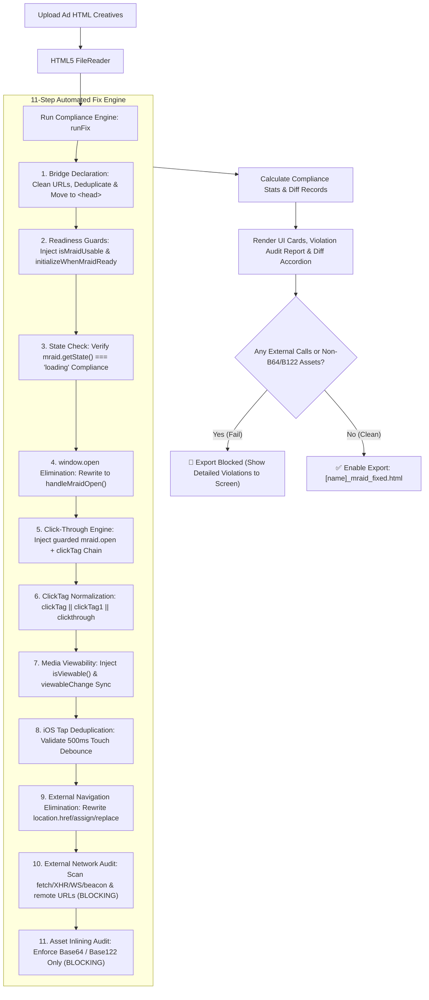

# MRAID Integration & Automated Compliance Fixer Reference

This document provides a comprehensive technical guide to the Mobile Rich Media Ad Interface Definitions (MRAID v2.0) compliance architecture, detailing both the operational runtime requirements and how [`mraid fixer.html`](file:///c:/Users/Irvin%20Udang/Desktop/MRAID%20Fixer/mraid%20fixer.html) automatically analyzes, repairs, and standardizes non-compliant ad creatives for AppLovin MIP and network ingestion.

---

## 1. Overview: How `mraid fixer.html` Fixes MRAID Creatives

Ad networks (particularly AppLovin MIP) run strict static regex validators and automated runtime sandboxes on uploaded HTML playable ads. Common authoring errors—such as invoking `window.open()`, omitting the `mraid.js` script tag from `<head>`, linking to absolute CDN URLs, calling `mraid.open()` without arguments, using negated state checks, or failing to pause media when off-screen—cause immediate creative rejection.

[`mraid fixer.html`](file:///c:/Users/Irvin%20Udang/Desktop/MRAID%20Fixer/mraid%20fixer.html) acts as a batch automated compliance and remediation engine. It runs non-destructive AST-like regex parsing and code rewriting directly in the browser via HTML5 `FileReader` and `Blob` APIs, producing validated `[filename]_mraid_fixed.html` creatives with full visual diff reporting.

### Automated Repair Pipeline



---

## 2. Detailed Breakdown: Automated Fixes in `mraid fixer.html`

The fixer engine executes 11 specialized checks in sequence. Below is how each check diagnoses violations and automatically rewrites the code.

---

### Check 1: Bridge Declaration (`mraid.js`)
* **Validator Rule**: `<script src="mraid.js"></script>` must appear exactly once inside the `<head>` tag, using a clean relative URL.
* **Violations Detected**:
  1. Absolute/CDN URLs (e.g., `https://.../mraid.js` or `//.../mraid.js`).
  2. Duplicate `mraid.js` script tags across the document.
  3. Placement inside `<body>` instead of `<head>`.
  4. Complete omission of `mraid.js`.
* **Automated Fix**:
  - Replaces all absolute URLs matching `/<script[^>]+src=["'][^"']*(?:https?:|\/\/)[^"']*mraid[^"']*\.js["'][^>]*>\s*<\/[s]cript>/gi` with `<script src="mraid.js"></script>`.
  - Deduplicates multiple occurrences, preserving only the first instance.
  - Strips the tag if located inside `<body>` and relocates it immediately into `<head>`.
  - Injects `<head><script src="mraid.js"></script></head>` if no tag or head exists.

```diff
- <script src="https://cdn.example.com/assets/mraid.js"></script>
+ <script src="mraid.js"></script>
```

---

### Check 2: Lifecycle Readiness Guards (`isMraidUsable` & `initializeWhenMraidReady`)
* **Validator Rule**: Ad creatives must not invoke MRAID methods before the host container fires the `'ready'` event or reaches the `'default'` / `'expanded'` state.
* **Violation Detected**: Calling MRAID APIs blindly on window load before bridge initialization completes.
* **Automated Fix**:
  If `isMraidUsable` and `initializeWhenMraidReady` are absent, the engine injects a standardized, bulletproof readiness helper script immediately after the `mraid.js` tag:

```html
<script>
(function(){
  var r = false, a = false;
  function track(m){
    if (a || !m || typeof m.addEventListener !== "function") return;
    try {
      m.addEventListener("ready", function(){ r = true; });
      a = true;
    } catch(e) {}
  }
  window.isMraidUsable = function(m){
    if (!m) return false;
    track(m);
    if (typeof m.getState !== "function") return true;
    try {
      var s = m.getState();
      return s === "default" || s === "expanded";
    } catch(e) { return r; }
  };
  window.trackMraidReadiness = track;
  window.initializeWhenMraidReady = function(init){
    var m = window.mraid;
    if (!m || typeof m.getState !== "function") { init(); return; }
    track(m);
    if (mraid.getState() === "loading") {
      var h = function(){
        if (typeof m.removeEventListener === "function") m.removeEventListener("ready", h);
        r = true;
        init();
      };
      if (typeof m.addEventListener === "function") {
        m.addEventListener("ready", h);
      } else {
        init();
      }
      return;
    }
    init();
  };
})();
</script>
```

---

### Check 3: Explicit State Check Compliance
* **Validator Rule**: Ad network ingestion regex validators specifically scan for the explicit positive equality token:
  ```javascript
  mraid.getState() === "loading"
  ```
* **Violation Detected**: Using inverted conditions like `mraid.getState() !== "loading"`, which can fail automated regex tests even though logical evaluation succeeds in JavaScript.
* **Automated Fix**:
  - Scans for negated patterns: `/mraid\.getState\s*\(\s*\)\s*!==?\s*["']loading["']/gi`.
  - Emits clear warning notifications to highlight non-compliant state guards so ad engineers can align with network-mandated regex syntax.

---

### Check 4: `window.open()` Elimination & Redirection
* **Validator Rule**: Playable ads running in mobile WebViews cannot use standard browser popups (`window.open`). MRAID requires delegating all outgoing clicks to `mraid.open(url)`.
* **Violation Detected**: `window.open(url, "_blank")`, `window.open()`, or `window["open"](...)`.
* **Automated Fix**:
  - The fixer searches for all invocations matching `/\bwindow(?:\.open|\[["']open["']\])\s*\(([^)]*)\)/gi`.
  - Replaces them with the safe, compliant wrapper `handleMraidOpen(...)`:
    - `window.open(targetUrl, "_blank")` $\rightarrow$ `handleMraidOpen(targetUrl)`
    - `window.open("")` or `window.open("about:blank")` $\rightarrow$ `handleMraidOpen()`

```diff
- window.open(window.clickTag || "https://example.com", "_blank");
+ handleMraidOpen(window.clickTag || "https://example.com");
```

---

### Check 5: MRAID v2.0 Click-Through Engine (`handleMraidOpen`)
* **Validator Rule**: The creative must provide a robust click-through mechanism invoking `mraid.open(targetUrl)` that resolves click targets and prevents runtime crashes.
* **Violations Detected**:
  1. No `mraid.open()` or `handleMraidOpen` defined anywhere in the creative.
  2. Calling bare `mraid.open()` without passing a target URL string, which triggers network rejection.
* **Automated Fix**:
  1. **Bare Open Correction**: If `mraid.open()` is called with no arguments, it is automatically rewritten to pass the resolved fallback chain:
     ```diff
     - mraid.open();
     + mraid.open(window.clickTag || window.clickTag1 || window.clickthrough || window.clickThrough || "");
     ```
  2. **Engine Injection**: If missing, injects the AppLovin MIP-compliant click-through engine into `<head>`:
     ```html
     <script>
     /* MRAID v2.0 Compliant Click-Through Engine (AppLovin MIP) - injected by MRAID Fixer */
     (function(){
       function getClickTarget(u){
         return u || window.clickTag || window.clickTag1 || window.clickthrough || window.clickThrough || "";
       }
       window.handleMraidOpen = function(targetUrl){
         var mraid = window.mraid;
         var url = getClickTarget(targetUrl);
         if (mraid && typeof mraid.open === "function") {
           var ready = true;
           if (typeof window.isMraidUsable === "function") {
             ready = window.isMraidUsable(mraid);
           } else if (typeof mraid.getState === "function") {
             var s = mraid.getState();
             ready = (s === "default" || s === "expanded");
           }
           if (!ready) {
             console.warn("[MRAID] bridge is not ready, attempting open anyway");
           }
           try {
             mraid.open(url);
             return true;
           } catch(err) {
             console.error("[MRAID] open threw", err);
           }
         }
         console.log("Network/browser fallback: ", url);
         return false;
       };
       window.handleClickAction = function(){ return window.handleMraidOpen(); };
       window["openClickThrough"] = window.handleClickAction;
     })();
     </script>
     ```

---

### Check 6: ClickTag Fallback Chain Normalization
* **Validator Rule**: Different DSPs, SSPs, and SDKs inject click targets using variable property names (`clickTag`, `clickTag1`, `clickthrough`, or `clickThrough`).
* **Automated Validation**:
  - Scans for standard multi-network variable resolution.
  - Guarantees that any CTA or converted `window.open` call evaluates the priority chain:
    $$\text{Target} = \text{Param} \parallel \text{window.clickTag} \parallel \text{window.clickTag1} \parallel \text{window.clickthrough} \parallel \text{window.clickThrough} \parallel \text{""}$$

---

### Check 7: Automated Media Viewability Lifecycle Management
* **Validator Rule**: MRAID v2.0 mandates that all audio and video playback must pause immediately when the ad loses viewability (`mraid.isViewable() === false`) and may resume only when viewability is restored.
* **Violation Detected**: `<video>` or `<audio>` elements present without `viewableChange` listeners or `mraid.isViewable()` checks.
* **Automated Fix**:
  Injects an automated media synchronization script right before `</body>`:

```html
<script>
/* MRAID Viewability Lifecycle - injected by MRAID Fixer */
(function(){
  var p = [];
  function sync(v){
    var all = Array.prototype.slice.call(document.querySelectorAll("video,audio"));
    if (!v) {
      all.forEach(function(el){
        if (!el.paused) { p.push(el); el.pause(); }
      });
    } else {
      p.forEach(function(el){ el.play().catch(function(){}); });
      p = [];
    }
  }
  function setup(){
    var m = window.mraid;
    if (!m) return;
    if (typeof m.isViewable === "function") {
      try { sync(m.isViewable()); } catch(e) {}
    }
    if (typeof m.addEventListener === "function") {
      try { m.addEventListener("viewableChange", sync); } catch(e) {}
    }
  }
  if (document.readyState === "loading") {
    document.addEventListener("DOMContentLoaded", setup);
  } else {
    setup();
  }
})();
</script>
```

---

### Check 8: iOS Multi-Touch & Tap Deduplication
* **Validator Rule**: In mobile Safari/WebViews, tapping a CTA often fires synthesized events in rapid succession (`pointerup` $\rightarrow$ `touchend` $\rightarrow$ `click`). Without deduplication, this can trigger multiple `mraid.open` calls or popup blocker interventions.
* **Automated Validation**:
  - Checks if event handlers incorporate a 500ms debounce guard (`handleTap` / `lastTapAt`):
    ```javascript
    let lastTapAt = 0;
    function handleTap(event) {
      const now = Date.now();
      if (now - lastTapAt < 500) return;
      if (event && (event.type === "touchend" || event.type === "pointerup" || event.type === "click")) {
        lastTapAt = now;
      }
      handleClickAction();
    }
    ```
  - Issues recommendations when touch listeners lack debouncing.

---

### Check 9: External Navigation & Redirect Elimination (`location.href` / `assign` / `replace`)
* **Validator Rule**: Mobile playable ads must not redirect top-level or window navigation directly via `location.href = ...`, `location.assign(...)`, or `location.replace(...)`. All navigation must be routed through `mraid.open()` to allow host apps to handle click conversions.
* **Violations Detected**: Direct window/frame location assignments (`window.location.href = url`, `location.assign(url)`, `location.replace(url)`).
* **Automated Fix**:
  - Rewrites all location redirects to `handleMraidOpen(...)`:
    ```diff
    - window.location.href = "https://example.com";
    + handleMraidOpen("https://example.com");
    ```

---

### Check 10: External Network Calls & Remote Endpoints Checker (Blocking Audit)
* **Validator Rule**: Major ad networks (AppLovin MIP, ironSource, Unity, Google) require playable creatives to be completely self-contained single-file HTML (offline-capable). Remote network APIs (`fetch`, `XMLHttpRequest`, `navigator.sendBeacon`, `WebSocket`, `EventSource`, `RTCPeerConnection`) and external CDN dependencies (remote `<script>`, `<link>`, ``, `<video>`, `<audio>`, CSS `url()`, `@import`) trigger strict policy rejections.
* **Violations Detected**:
  1. Remote network API requests: `fetch("https://...")`, `XMLHttpRequest`, `navigator.sendBeacon()`, `WebSocket`, `EventSource`, `RTCPeerConnection`.
  2. Remote `<script>` CDN tags (excluding `mraid.js`).
  3. Remote `<link>` stylesheets and Google Fonts.
  4. Remote media tags (``, `<video>`, `<audio>`, `<iframe>`, `<embed>`, `<object>`).
  5. Remote CSS `\burl("https://...")` and `@import` assets.
* **False-Positive Prevention**:
  - `fetch()` with inlined Base64/Base122 data URIs (`data:...;base64,...`), in-memory blob URIs (`blob:...`), or runtime variables/template expressions (`fetch(e)`, `fetch(blobUrl)`, `fetch(\`data:...;base64,${data}\`)`) are safely recognized as offline assets and **not** falsely flagged.
  - Word boundary `\burl(` prevents matching JavaScript APIs like `URL.createObjectURL(blob)` as CSS `url()` calls.
* **Automated Audit & Export Blocker**:
  - Itemizes all remote endpoints and dependencies with exact line numbers, code snippets, and remediation steps.
  - **Flagged as Critical (`FAIL`)**: If any external calls exist, the export button is disabled and a detailed audit report is rendered on screen. Export is blocked until all external calls are resolved.

---

### Check 11: Asset Inlining Compliance: Base64 / Base122 Only (Blocking Audit)
* **Validator Rule**: All multimedia assets (textures, sprites, audio clips, fonts, vector files, 3D models) must be inlined directly within the HTML document as Base64 data URIs (`data:...;base64,...`) or Base122 encoded strings (`data:...;base122,...` / Base122 decoder). Any local/relative file reference (e.g. ``, `new Audio("sound.mp3")`, `url("bg.jpg")`, `fetch("model.glb")`) will fail at runtime because only the `.html` file is deployed to the ad SDK container.
* **Violations Detected**:
  1. Local/relative `` tags lacking compliant Base64 or Base122 data URIs.
  2. Local/relative `<video>`, `<audio>`, or `<source>` media paths.
  3. Local/relative `<link rel="stylesheet" href="...">` files.
  4. Local/relative `<script src="...">` files (excluding `mraid.js`).
  5. CSS `url("...")` references to unbundled local files (`.png`, `.jpg`, `.webp`, `.woff2`, `.mp3`, etc.).
  6. JavaScript relative file path instantiations (`new Audio("sound.mp3")`, `image.src = "hero.png"`).
  7. Unbundled local file targets in `fetch()` (e.g., `fetch("model.glb")`, `fetch("./data.json")`).
* **Base64 / Base122 Compliance & False-Positive Elimination**:
  - CSS `url()` and `fetch()` arguments are verified:
    - Base64 data URIs (`data:...;base64,...`), Base122 data URIs (`data:...;base122,...`), inlined SVG data URIs (`data:image/svg+xml...`), and in-memory blobs (`blob:...`) pass with zero false positives.
    - Bundler template literals (e.g., ``url(`${_hero_png}`)``, ``fetch(`${modelB64}`)``) and JS variable arguments (`fetch(assetUrl)`) are recognized as bundled Base64 assets and pass cleanly.
    - If `url()` or `fetch()` targets an un-encoded relative path (e.g., `url("hero.png")` or `fetch("model.glb")`), it is immediately flagged with line number, snippet, and Base64 conversion remedy.
* **Automated Audit & Export Blocker**:
  - Itemizes detected unbundled relative files and non-Base64/Base122 references with exact line numbers and code snippets.
  - **Flagged as Critical (`FAIL`)**: If any non-Base64/non-Base122 assets exist, export is disabled and a detailed audit inspector is displayed on screen.

---

## 3. Implementation Details in `mraid fixer.html`

[`mraid fixer.html`](file:///c:/Users/Irvin%20Udang/Desktop/MRAID%20Fixer/mraid%20fixer.html) includes specific design and architectural patterns to safely modify ad code in the browser:

1. **Parser-Safe Script Tag Literal Escaping (`\x3c/script>`)**:
   When writing an HTML file that contains inline JavaScript generating `<script>` tags, writing `</script>` directly inside string literals causes browser HTML parsers to prematurely terminate the enclosing `<script>` block. `mraid fixer.html` escapes closing tags as `\x3c/script>` to ensure uninterrupted DOM script execution.

2. **Non-Destructive Diff Tracking**:
   Every transformation records an entry in a `diffs` array containing `label`, `before`, and `after` snippets. The tool renders these changes in an interactive accordion view, allowing developers to inspect exact code adjustments before exporting.

3. **Multi-File Batch Workflow & Export Blocking**:
   Supports concurrent drag-and-drop or batch file selection. Files are parsed asynchronously with progress bars, presented in categorized tabs with status badges (`✓ clean`, `X fixes`, `X warn`, `X blocked`). If critical violations (external calls or unbundled/non-Base64/Base122 assets) are present, single-file and batch exports are strictly disabled until the creative is fully self-contained.

4. **Visual Detailed Violation Inspector & Asset Report**:
   Renders an interactive breakdown directly on screen with category filter pills (`All`, `External Calls`, `Non-B64/B122 Assets`), line numbers, code snippets, and remediation guidance.

---

## 4. MRAID Compliance & Remediation Matrix

| Check / Area | Non-Compliant Pattern | Compliant Standard | Fix Applied by `mraid fixer.html` |
|---|---|---|---|
| **Bridge URL** | `<script src="https://.../mraid.js">` | `<script src="mraid.js"></script>` | Replaces with relative path |
| **Bridge Location** | In `<body>` or multiple tags | Exactly 1 tag in `<head>` | Deduplicates and moves to `<head>` |
| **Bridge Presence** | No `mraid.js` declared | Declared in `<head>` | Injects relative tag in `<head>` |
| **Readiness** | Calling methods before ready | Guarded by `isMraidUsable()` | Injects `isMraidUsable` & `initializeWhenMraidReady` |
| **State Regex** | `mraid.getState() !== "loading"` | `mraid.getState() === "loading"` | Flags warning for validator compliance |
| **CTA Click Method** | `window.open(url)` | `mraid.open(url)` | Rewrites `window.open()` to `handleMraidOpen()` |
| **Click Target** | Hardcoded or empty `mraid.open()` | Param or fallback chain | Injects `getClickTarget` fallback chain |
| **Click Engine** | Missing click handler | Standardized `handleMraidOpen` | Injects full `handleMraidOpen()` engine |
| **Media Lifecycle** | Media plays in background | Pauses when `isViewable() === false` | Injects `viewableChange` audio/video pause sync |
| **iOS Touch** | Rapid multi-fire events | 500ms tap deduplication | Validates `handleTap` debounce pattern |
| **Navigation Redirects** | `location.href = url` / `assign()` | `handleMraidOpen(url)` | Rewrites direct navigation to `handleMraidOpen()` |
| **External Dependencies** | Remote CDNs, XHR, fetch, external img/fonts | 100% self-contained single-file HTML | **FLAGS FAIL & BLOCKS EXPORT**: detailed on-screen report |
| **Asset Inlining** | Unbundled relative assets or non-B64/B122 | Inline Base64 (`data:`) or Base122 | **FLAGS FAIL & BLOCKS EXPORT**: detailed on-screen report |

---

## 5. Runtime Architecture Reference (Dual-Environment MIP)

When building complex playables (e.g. game creatives with an embedded end card):
1. **Top-Level Creative (Main MIP Playable)**: The root application container responsible for interactive gameplay, audio effects, and viewport management. Uses `initializeWhenMraidReady(mountCreative)` to mount root elements.
2. **Embedded End-Scene Container (SIP Template)**: An isolated `<iframe>` (rendered via `srcDoc` or dynamic DOM) containing the end-card CTA and video assets. Declares its own `mraid.js` bridge and runs `initializeMraidRuntime()` using the standard validator check:
   ```javascript
   function initializeMraidRuntime() {
     if (typeof mraid === "undefined") {
       init();
     } else {
       if (mraid.getState() === "loading") {
         mraid.addEventListener("ready", init);
       } else {
         init();
       }
     }
   }
   ```

---

## 6. Verification Checklist Before Export

Before publishing creatives fixed with [`mraid fixer.html`](file:///c:/Users/Irvin%20Udang/Desktop/MRAID%20Fixer/mraid%20fixer.html):
- [x] Creative contains `<script src="mraid.js"></script>` strictly in `<head>`.
- [x] Zero instances of `window.open()` exist in application code.
- [x] Zero direct `location.href` or `location.assign()` external redirect calls.
- [x] `handleMraidOpen()` wraps all CTA interactions.
- [x] All `mraid.open()` calls supply a valid destination string from the `clickTag` chain.
- [x] Initial loading states check `mraid.getState() === "loading"`.
- [x] Audio and video elements pause when `mraid.isViewable()` returns `false`.
- [x] Touch interactions implement debouncing for iOS Safari event sequences.
- [x] No unauthorized external network APIs (`fetch`, `XMLHttpRequest`, `sendBeacon`, `WebSocket`) or remote CDN/asset URLs (excl. `mraid.js`).
- [x] All multimedia assets, scripts, and styles are inlined via Base64 (`data:` URI) with zero unbundled local file paths.

